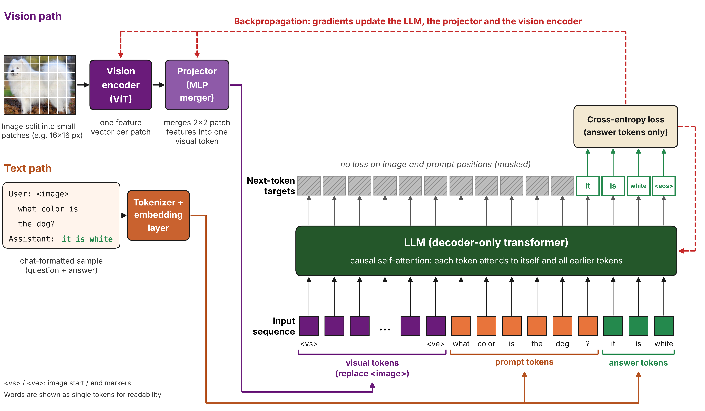
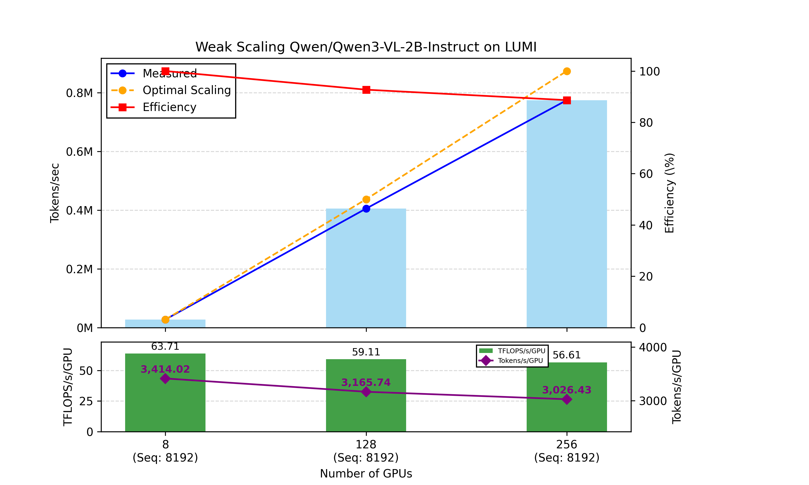
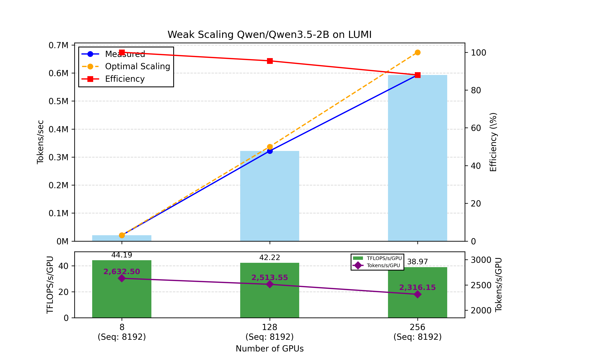
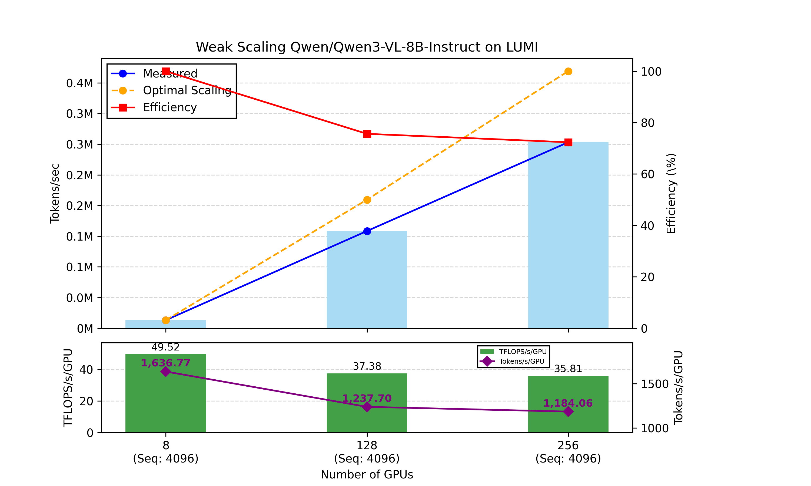
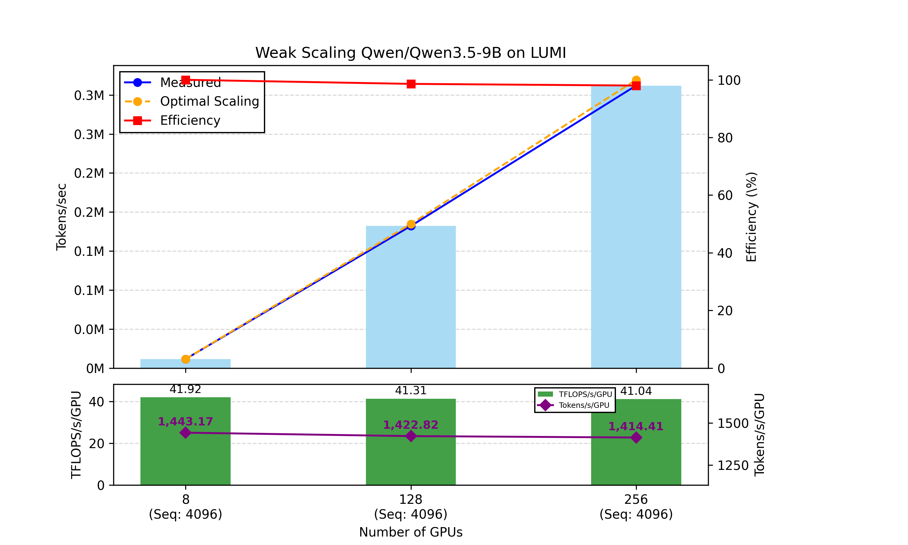

# Performance and Scalability Analysis of VLMs on LUMI

## Introduction

Vision Language Models (VLMs) extend Large Language Models (LLMs) with a vision encoder and a projection layer that maps image features into the language model's embedding space. The model can then reason jointly over images and text, for example answering questions about an image. Widely used open VLM families include Qwen-VL, LLaVA and InternVL.

The extra vision components, and the longer input sequences created by visual tokens, make VLM training more expensive than text-only LLM training. At that cost, two questions decide how well a supercomputer is used:

1. **Performance:** how much useful work each GPU delivers, measured as **training throughput** in tokens per second per GPU and **achieved compute** in TFLOP/s per GPU.
2. **Scalability:** how that per-GPU performance holds up as the job grows from **1 node to 16 and 32 nodes**.

This post reports four Qwen vision language models trained on the LUMI supercomputer. The results are practical observations from a fixed setup, not an exhaustive benchmark study, and they should be read as rough performance estimates.

## Metrics

| Metric | Definition | What it tells us |
|---|---|---|
| **Tokens/s/GPU** | Training tokens processed per second, divided by the number of GPUs (GCDs) | Throughput seen by the user |
| **Aggregate tokens/s** | Tokens/s/GPU × number of GPUs | Throughput of the whole job |
| **TFLOP/s per GPU** | Floating-point operations executed per second per GPU | How hard the hardware is being worked|
| **MFU** (Model FLOPs Utilization) | Achieved TFLOP/s per GPU ÷ peak TFLOP/s per GPU | Fraction of the theoretical peak actually used |
| **Weak scaling efficiency** | $$ E_{\text{weak}} = \frac{T_1}{T_p} \times 100\% $$ | how execution time changes as the problem size and number of processors increase proportionally, keeping the workload per processor constant |

All runs are **weak scaling** experiments: the per-GPU workload (sequence length and micro-batch) is held constant, so the global batch grows with the number of GPUs. 

## System: LUMI-G

All experiments ran on LUMI-G, the GPU partition of the LUMI supercomputer. Each LUMI-G node has:

- 1 × 64-core AMD EPYC 7A53 "Trento" CPU
- 4 × AMD Instinct MI250X accelerators, each with 2 Graphics Compute Dies (GCDs), giving **8 GCDs per node**; each GCD appears as a separate GPU to Slurm
- 64 GB HBM2e per GCD, **512 GB GPU memory per node**
- AMD Infinity Fabric links between GCDs within a node
- 4 × HPE Slingshot-11 network interfaces (200 Gb/s each, one per MI250X) for inter-node communication

Throughout this post, "GPU" means one GCD. The theoretical peak dense FP16/BF16 matrix throughput of an MI250X is 383 TFLOP/s, or about **191.5 TFLOP/s per GCD**; this is the reference used for the MFU values below.


The communication hierarchy matters for scaling. Within a node, GPU-to-GPU communication uses AMD Infinity Fabric, while communication between nodes traverses the HPE Slingshot network. Distributed collectives such as all-reduce, all-gather, and reduce-scatter may therefore incur additional inter-node communication costs when a job spans multiple nodes. Because inter-node communication generally offers less bandwidth and higher latency than local GPU interconnects, scaling from 1 to 16 nodes can introduce an additional communication overhead.

Three configurations were tested:

| Nodes | GPUs (GCDs) | Total GPU memory |
|---|---|---|
| 1 | 8 | 512 GB |
| 16 | 128 | 8 TB |
| 32 | 256 | 16 TB |

## Experimental Setup

### Data and data loading

The models were trained on 1 million synthetic image–text visual question answering samples, generated with the method described [here](https://github.com/shanshanwangcsc/synth-data-bench-training/blob/main/README_LUMI.md). Each sample is an image paired with a short conversation, for example:

```json
{
  "id": "6916c960-824b-4275-80a1-4874d5ed17e2",
  "conversations": [
    {"from": "human", "value": "what color is the dog?"},
    {"from": "gpt", "value": "it is white."}
  ]
}
```

At scale, the input pipeline can limit throughput just as much as compute or communication. To keep it from becoming the bottleneck:

- The data is stored in **WebDataset** format: 1,000 tar shards of 1,000 samples each (`shard-000000.tar` … `shard-000999.tar`), each sample being a `.jpg` + `.json` pair. Large sequential reads from a few big files avoid the metadata overhead of millions of small files on the Lustre parallel filesystem.
- The **Energon dataloader** is optimized for high-speed multi-rank training and can handle very large datasets

### Models

Four models from the Qwen family were evaluated, covering two size classes and two model generations: Qwen3-VL-2B-Instruct, Qwen3.5-2B, Qwen3-VL-8B-Instruct and Qwen3.5-9B.

### Training frameworks

- **Distributed Data Parallel (DDP)** keeps a full copy of the model, gradients and optimizer states on every GPU. It is simple and efficient as long as the full training state fits in GPU memory, which is the case for the 2B models.
- **Fully Sharded Data Parallel (FSDP)** shards parameters, gradients and optimizer states across GPUs. This lowers the memory footprint enough to train the 8–9B models, at the cost of more communication.
- **Megatron-LM**
TO BE ADDED

### Overall workflow


<p align="center">
  
</p>

The figure above shows a simplified view of one training step for a single image–text sample. In the vision path, the image is split into small patches (e.g. 16×16 pixels), and a transformer-based vision encoder (ViT) produces one feature vector per patch. A projector (an MLP merger that also combines neighbouring 2×2 patch features) maps these features into the language model's embedding space, producing the visual tokens. In the text path, the question and answer are formatted with the chat template, which contains an `<image>` placeholder, and are converted into token embeddings by the tokenizer and embedding layer. The visual tokens, enclosed by image start and end markers (`<vs>`, `<ve>`), replace the placeholder, giving one input sequence of visual, prompt and answer tokens. The decoder-only LLM processes this sequence with causal self-attention, so each token attends only to itself and earlier tokens, and the output at each position is trained to predict the next token. The cross-entropy loss is computed only on the answer tokens ("it", "is", "white" and the end-of-sequence token); image and prompt positions are masked. Gradients then flow back from the loss through the LLM, the projector and the vision encoder. The vision encoder adds compute on top of the language model, and the visual tokens lengthen each sequence; both affect throughput.

## Results

In each figure below, the top panel shows aggregate throughput (blue: measured; orange dashed: ideal linear scaling) and weak scaling efficiency (red, right axis). The bottom panel shows TFLOP/s per GPU (green bars) and tokens/s/GPU (purple line).

**Qwen3-VL-2B-Instruct**


**Qwen3.5-2B**


**Qwen3-VL-8B-Instruct**


**Qwen3.5-9B**



### Key takeaways

- **Per-GPU performance within one node** for these VLMs ranges from about 42 to 64 TFLOP/s per GCD (22–33% MFU), with 1.2–3.4 K tokens/s/GPU depending on model size.
- **Scaling to 32 nodes (256 GCDs) works well** for all four models, with 72–98% weak scaling efficiency and up to 775 K tokens/s aggregate throughput.

## Code

The training code and LUMI job scripts are available in the [vlm-training repository](https://github.com/shanshanwangcsc/vlm-training/blob/main/README_LUMI.md).

## Acknowledgement

We would like to thank Tomas Ockier Poblet from CVC (Computer Vision Center) for providing the synthetic data generation code. 

> **Project Context** 
This research is conducted as part of the **ELLIOT project** (*European Large Open Multi-Modal Foundation Models for Robust Generalization on Arbitrary Data Streams*), which aims to advance open, multimodal generalist foundation models leveraging European supercomputing infrastructure. ELLIOT is funded by the EU's Horizon Europe programme.
